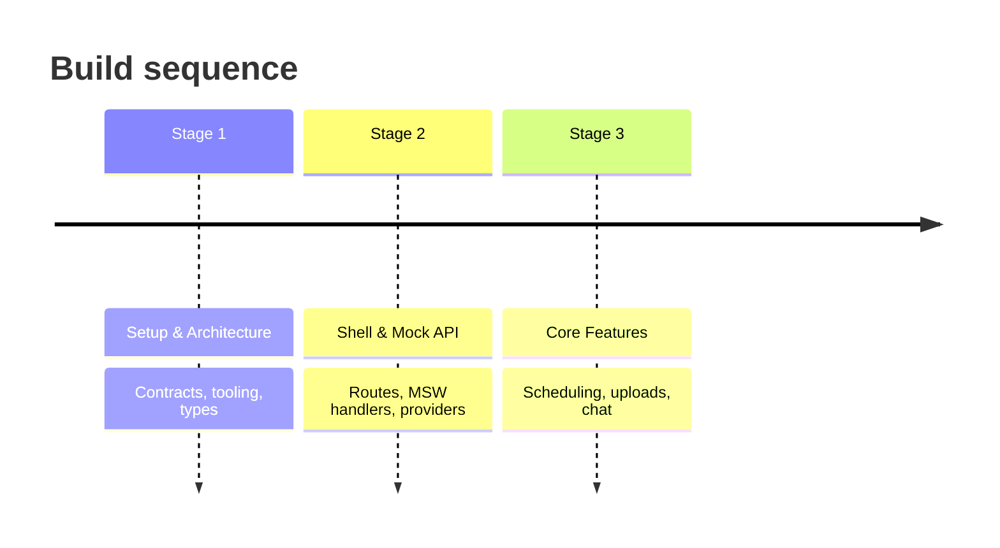
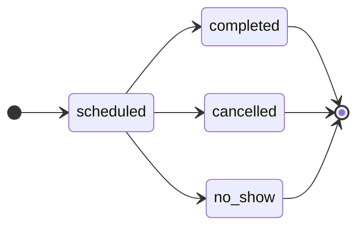
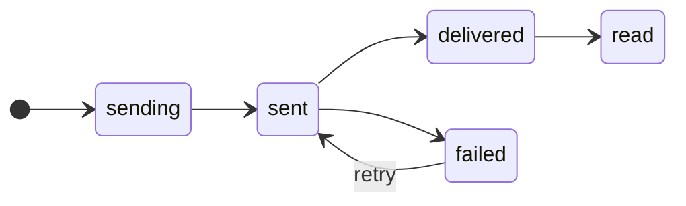
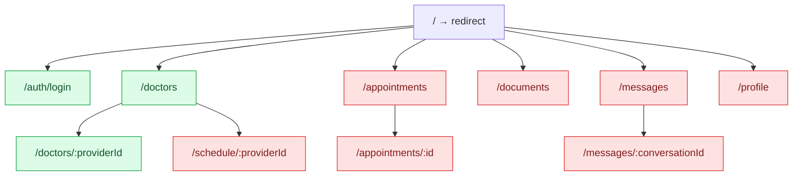
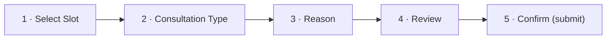
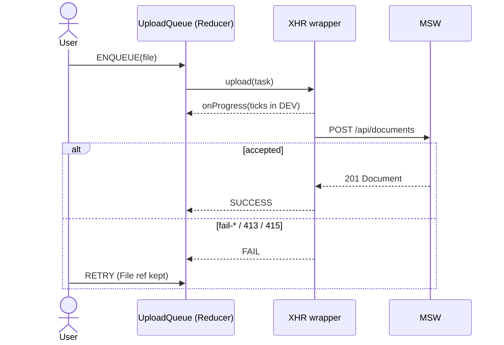
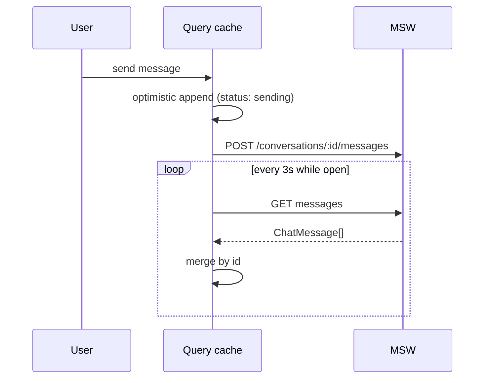
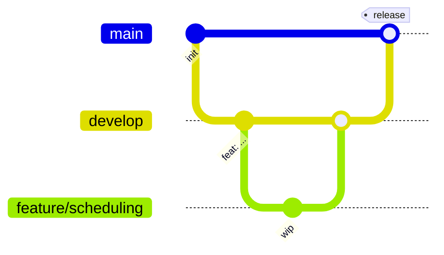

# Telemedicine Portal

Architecture & Build Plan

---
layout: two-cols-header
---

# Problem & Scope

::left::

**In scope**

- Provider search & filtering
- Multi-step scheduling wizard
- Document uploads with progress
- Live chat simulation
- Mock authentication

::right::

**Out of scope**

- Real payments
- Real video / audio
- Real backend
- Real PHI handling & HIPAA compliance
- Notifications & email

::bottom::

**Why mock-only** — every request is intercepted by MSW v2; no network call leaves the browser, so no real patient data is ever at risk.

---
layout: default
---

# The Three Stages

Each stage ships behind the contract frozen in `docs/` — no stage re-opens a locked decision.

---
layout: default
---

# Locked Decisions (excerpt)

| # | Area | Decision |
|---|---|---|
| 1 | Forms | react-hook-form + zod; zod owns **form** types only |
| 2 | Entity types | Hand-written in `src/types/*`, **not** inferred from zod |
| 3 | Wizard | Single `useForm` across all steps; `trigger()` gates progression |
| 4 | Auth | Mock JWT in `localStorage`; guards via React Router 7 `loader` |
| 5 | 401 handling | Global handler in `apiClient` clears session, redirects to login |
| 6 | Upload transport | **XHR** (not `fetch`); Promise wrapper with `onProgress` |
| 7 | Upload state | Progress in Context + Reducer, **not** TanStack Query |

Seven decisions that constrain Phase 1. Full table (18 rows) in `docs/decisions.md`.

---
layout: default
---

# Tech Stack

| Layer | Choice |
|---|---|
| UI | React 19, Tailwind v4, shadcn/ui on **Base UI** primitives |
| Routing | React Router 7 (data router, loader guards) |
| Language & build | TypeScript (strict), Vite |
| Server state | TanStack Query v5 |
| Forms | react-hook-form + zod |
| Mocking | MSW v2 |
| Tests | Vitest + React Testing Library, Playwright |

---
layout: section
---

# Domain & State

---
layout: default
---

# Domain Model

---
layout: two-cols
---

# State Ownership

**Server state** → TanStack Query

- Specialties — `staleTime: Infinity`
- Provider list — keyed by `ProviderFilters`
- Provider detail — `staleTime: 5 min`
- Slots — keyed by `(providerId, from, to)`
- Appointments, documents — invalidated on mutation
- Conversations — poll 10 s (background off)
- Messages — poll 3 s, **merge by id**

::right::

**Client state** → Context + Reducer + URL

- Auth session — Reducer, persisted to `localStorage`
- Upload queue — Reducer, holds `File` refs for retry
- Wizard draft — Reducer, reset on unmount
- Provider filters — **URL search params**, the source of truth
- Chat composer, open dialogs — local `useState`
- Theme — Reducer, `localStorage` (if dark mode ships)

One rule: never the same data in two places.

---
layout: default
---

# Route Map & Auth

Green = public · Red = protected

`requireAuth()` runs in a route `loader` — no flash of protected content.

---
layout: default
---

# API Contract

| Feature | Endpoints |
|---|---|
| Auth | `POST /auth/login`, `POST /auth/logout`, `GET /auth/me` |
| Specialties | `GET /specialties` |
| Providers | `GET /providers`, `GET /providers/:id`, `GET /providers/:id/slots` |
| Appointments | `POST /appointments`, `GET /appointments`, `GET /appointments/:id`, `PATCH /appointments/:id` |
| Documents | `GET /documents`, `POST /documents` (multipart), `DELETE /documents/:id` |
| Chat | `GET /conversations`, `GET /conversations/:id/messages`, `POST /conversations/:id/messages` |

Base `/api`, `Bearer` token everywhere except `/auth/*`. Mock latency 200–600 ms.

---
layout: section
---

# Feature Deep-Dives

---
layout: default
---

# Scheduling Wizard

- **Single `useForm` across all steps** — no per-step form instances.
- `trigger([...])` gates each per-step transition; nothing submits until step 5.
- Draft lives in `wizardReducer` — reset on unmount or successful submit.
- `POST /appointments` can answer `409 SLOT_TAKEN`; submit is the only network write.

---
layout: default
---

# Upload Pipeline

Progress lives in Context + Reducer — Query cannot model a transfer in flight.

---
layout: default
---

# Chat Polling

- **Merge by id — never replace the array.** A poll must not wipe an optimistic send.
- Server messages win; local `sending` messages with no server twin are preserved.
- `<MessageBubble>` is `React.memo`'d with stable keys — 3 s polling janks without it.

---
layout: section
---

# Quality & Process

---
layout: default
---

# Testing Strategy

| Path | Threshold |
|---|---|
| `src/features/**/reducer.ts` | 90% |
| `src/features/**/schemas.ts` | 90% |
| `src/hooks/**` | 85% |
| `src/features/**/api.ts` | 80% |
| `src/components/primitives/**` | no threshold |
| Everything else | no global minimum |

Per-directory thresholds, never global — global ones just encourage testing presentational wrappers.
Playwright covers the 5 critical flows: login/logout, guard redirect, upload success, upload retry, optimistic send.

---
layout: default
---

# Git Workflow

- `main` is protected; `develop` integrates; one `feature/*` branch per slice.
- Conventional Commits, enforced by commitlint + husky — machine-readable history, changelogs later.

---
layout: default
---

# Risks & Open Questions

- **shadcn/Base UI spike** — 30 min before Phase 1. Install `button`, `dialog`, `sheet`, `tabs`, `form` on Base UI primitives and confirm all render.
- **Fallback if the spike fails** — Radix for that component only, documented in the decisions table (row 12).
- **Dark mode is undecided** — `docs/decisions.md` row 14 and `docs/design-tokens.md` both still read `<DECIDE: yes / no>`. Must be locked before design tokens are finalised.
- **Chat transport** — polling is fine for a simulation; SSE/WebSocket is the documented revisit trigger if real-time becomes a requirement.

---
layout: default
---

# Next: Phase 1

- **Tooling** — Vite + TS strict, Tailwind v4 `@theme` tokens, Vitest + RTL, commitlint + husky.
- **Contracts** — entity types hand-written in `src/types/*` from `docs/domain.ts`; zod for form schemas only.
- **Mock API** — MSW v2 handlers for all six feature groups, with the DEV simulated conditions.
- **Client** — `apiClient` with the global 401 handler; `queryKeys` centralised in `src/lib/queryKeys.ts`.
- **Providers** — `auth` / `upload` / `wizard` reducers, each in its own Context with a `use*` hook that throws outside its provider.
- Spike first: the Base UI component check gates the shell work.

---
layout: center
---

# Questions

docs/ · deck/ · git log --oneline
